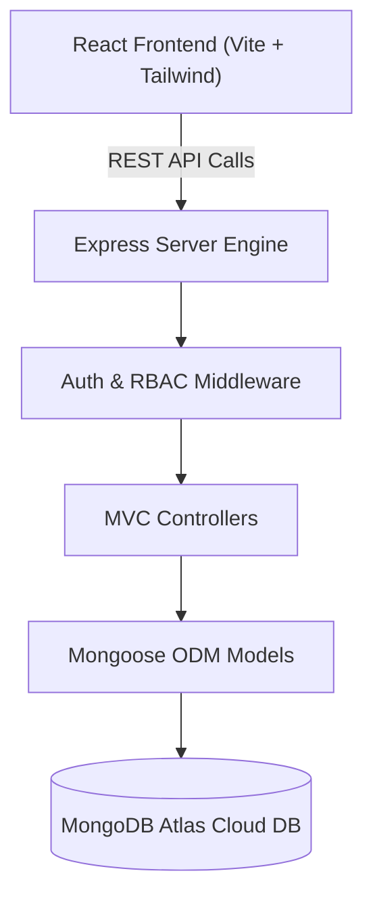
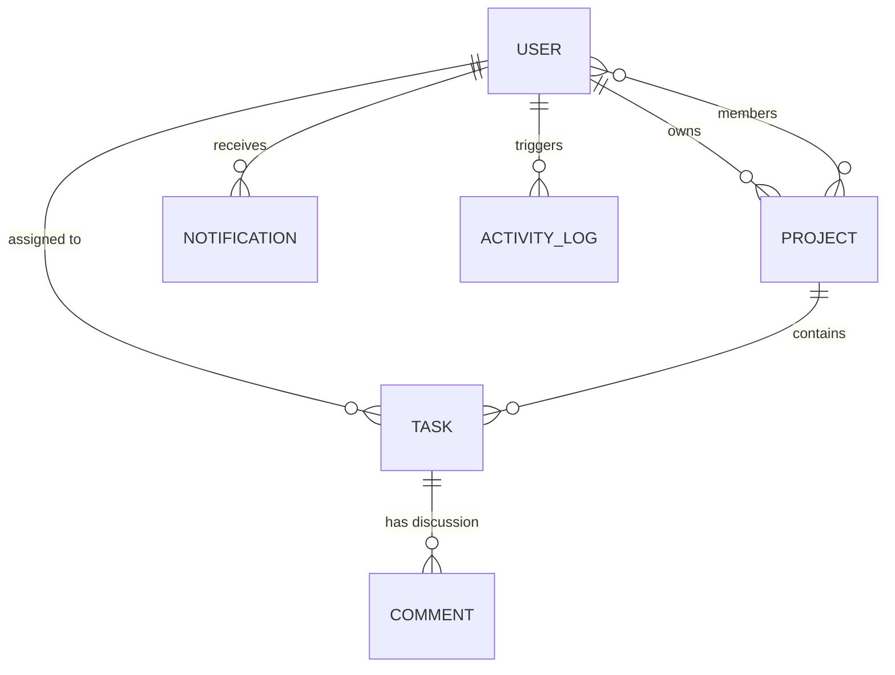

# WorkNest — Team Project & Task Management Platform

> **Tagline:** Plan projects. Organize teams. Deliver work.

[](https://aurex.tech)
[](https://nodejs.org)
[](https://jestjs.io)
[](#important-project-approval-notice)

---

## Important Project Approval Notice
According to the official **AUREX Month 3 Internship Requirements** (Section 108: *"Each intern/team will be assigned or approved a real-world project"*), **WorkNest** is a candidate project proposal categorized under *"Task/project management system"* (Section 112). It is submitted for formal mentor evaluation and sign-off.

---

## 1. Project Overview
**WorkNest** is a production-grade full-stack project management platform that empowers cross-functional teams and enterprises to organize initiatives, allocate tasks, collaborate through task comments, and monitor team performance from a centralized, role-governed dashboard.

---

## 2. Problem Statement
Many contemporary task applications are built as single-user toys or basic CRUD forms lacking enterprise capabilities:
- Lack of genuine backend-enforced Role-Based Access Control (RBAC).
- Static or disconnected dashboard widgets displaying fabricated metrics.
- Missing referential constraints (e.g. assigning non-members to private projects).
- Insecure password storage and secrets leakage.

WorkNest addresses these challenges with a resilient multi-tier architecture, verified relational database modeling, and an editorial-inspired SaaS user experience.

---

## 3. Project Objectives
1. Build a robust, decoupled MERN application adhering to industry full-stack patterns.
2. Implement 3 real user roles (`admin`, `manager`, `member`) with strict backend enforcement.
3. Provide an interactive Kanban board with persistent status synchronization.
4. Enforce enterprise security: zero secret leakage, bcrypt password hashing, and stateless JWT tokens.
5. Provide comprehensive automated and manual testing evidence.

---

## 4. Target Users & User Roles

| Role | Target Persona | Key Capabilities |
| :--- | :--- | :--- |
| **Administrator** (`admin`) | Executive / IT Lead | Full system oversight, user account management, role elevation, and platform metrics audit. |
| **Project Manager** (`manager`) | Scrum Master / Team Lead | Workspace creation, member delegation, task planning, and deadline tracking. |
| **Team Member** (`member`) | Individual Contributor | Personal task execution, Kanban status transitions, comments, and notification tracking. |

---

## 5. Core Features
- **Public Marketing Website:** Responsive landing page featuring product previews, features breakdown, security directives, and technical FAQ.
- **Role-Based Authentication:** Secure registration and login with bcrypt hashing (10 salt rounds), JWT authentication, and protected client routes.
- **Role-Tailored Dashboards:** Real-time metrics computed dynamically from MongoDB collections.
- **Interactive Kanban Boards:** Drag-and-drop workflow across To Do, In Progress, In Review, and Completed stages with persistent REST updates.
- **Task Collaboration:** Contextual task-level comments with author ownership verification.
- **In-App Notification Center:** Unread count badges and alerts for task assignments and status updates.
- **Audit Activity Trail:** Automated background logging into the `ActivityLog` collection for all major mutations.

---

## 6. Technology Stack

### Frontend
- **Framework:** React.js (v18+) with Vite
- **Styling:** Tailwind CSS + Custom Editorial SaaS Palette (Warm Ivory `#FAF9F6`, Forest Green `#173D32`, Primary Green `#286B52`)
- **Typography:** DM Serif Display (Headings) + Inter / DM Sans (Interface)
- **Routing:** React Router DOM (v6) with `ProtectedRoute` & `RoleGuard`
- **State:** React Context API (`AuthContext`, `ToastContext`)
- **HTTP Client:** Axios with bearer token interceptors
- **Icons:** Lucide React

### Backend
- **Runtime:** Node.js (v18+ LTS / v20+)
- **Framework:** Express.js (Modular MVC Architecture)
- **Database ODM:** Mongoose (v8+)
- **Authentication:** JSON Web Tokens (`jsonwebtoken`) & `bcryptjs`
- **Security:** Helmet, CORS, `express-rate-limit`, `cookie-parser`

### Database
- **Engine:** MongoDB Atlas Cloud / MongoDB Local (Document-Oriented NoSQL Database)
- **ODM:** Mongoose v8+ with schema validation, indexes, timestamps, and virtuals
- **Entities:** 6 Collections with document references (`User`, `Project`, `Task`, `Comment`, `Notification`, `ActivityLog`)

### Testing & Tools
- **Test Runner:** Jest + Supertest (28/28 Passing Integration & Security Tests, 100% Pass Rate)
- **API Testing:** Postman Collection (`docs/postman/WorkNest_API.postman_collection.json`) with 21 Requests

---

## 7. System Architecture & Data Flow



---

## 8. Database Schema Blueprint



---

## 9. Project Folder Structure

```text
AUREX-Month-3-WorkNest/
├── backend/
│   ├── src/
│   │   ├── config/          # DB & Environment Configuration
│   │   ├── controllers/     # Auth, User, Project, Task, Comment Controllers
│   │   ├── middleware/      # authenticate, authorize, validate, errorHandler
│   │   ├── models/          # User, Project, Task, Comment, Notification, ActivityLog
│   │   ├── routes/          # Modular Express REST Routes
│   │   ├── utils/           # JWT Tokens, Notifier, ActivityLogger
│   │   ├── app.js           # Express App Configuration
│   │   └── server.js        # Server Entrypoint
│   ├── tests/               # Jest & Supertest Integration Test Suite
│   ├── render.yaml          # Render Cloud Deployment Config
│   ├── package.json
│   └── .env.example
├── frontend/
│   ├── src/
│   │   ├── components/      # Common, Layout, Projects, Tasks, Notifications
│   │   ├── context/         # AuthContext, ToastContext
│   │   ├── pages/           # Public, Auth, Dashboard, Projects, Tasks, Admin, Profile
│   │   ├── routes/          # AppRoutes, ProtectedRoute, RoleGuard
│   │   ├── services/        # Axios API Client & Services
│   │   ├── App.jsx
│   │   └── main.jsx
│   ├── vercel.json          # Vercel SPA Routing Configuration
│   ├── tailwind.config.js
│   ├── package.json
│   └── .env.example
├── docs/                    # Technical & Architecture Specifications
│   ├── architecture.md
│   ├── database-design.md
│   ├── api-documentation.md
│   ├── testing-report.md
│   └── postman/             # Postman Test Collection
├── requirements/            # AUREX Original Documents & Analysis
│   ├── REQUIREMENT_ANALYSIS.md
│   ├── REQUIREMENT_TRACEABILITY.md
│   ├── FOUR_WEEK_DEVELOPMENT_PLAN.md
│   └── SUBMISSION_CHECKLIST.md
├── submission/              # Formal Internship Submission Deliverables
└── README.md
```

---

## 10. Prerequisites & Setup Instructions

### Prerequisites
- Node.js (v18.0.0 or higher)
- npm (v9.0.0 or higher)
- MongoDB (Local instance or MongoDB Atlas Connection String)

### 1. Clone & Setup Repository
```bash
git clone https://github.com/Sahrish351/aurex-internship-month-3-worknest.git
cd aurex-internship-month-3-worknest
```

### 2. Backend Setup
```bash
cd backend
npm install
cp .env.example .env
# Configure your MONGODB_URI and JWT_SECRET in .env
npm run dev
# Server runs on http://localhost:5000
```

### 3. Frontend Setup
```bash
cd ../frontend
npm install
cp .env.example .env
npm run dev
# Frontend runs on http://localhost:5173
```

---

## 11. Automated Testing Instructions

Execute the automated backend test suites (Core API Security + MongoDB Integration):
```bash
cd backend
npm test
```
All 28 automated integration tests will execute across both test suites, validating:
- Service health check diagnostics and database connection state
- Request validation middlewares and error boundary formatting
- Bcrypt password hashing (10 salt rounds) and comparison
- JWT token signing, verification, and tamper rejection
- Role authorization guards (`admin`, `manager`, `member`)
- Registration privilege escalation immunity
- Full project CRUD lifecycle with cascading cleanup
- Task creation, member assignment enforcement, and Kanban status patching
- Contextual task comment addition, author-verified editing (`PUT`), and deletion
- In-app notification delivery and dynamic role-specific dashboard metrics

### Seed Demo Data
To populate realistic demo data in MongoDB Atlas:
```bash
cd backend
npm run seed
```
Demo Accounts:
- **Admin:** `admin@worknest.test` / `AdminPassword123!`
- **Manager:** `manager@worknest.test` / `ManagerPassword123!`
- **Member:** `member@worknest.test` / `MemberPassword123!`

---

## 12. Postman API Testing
Import the collection located at:
`docs/postman/WorkNest_API.postman_collection.json`
Configure the `baseUrl` variable to `http://localhost:5000/api` and execute test runs.

---

## 13. Production Deployment Preparation
- **Frontend (Vercel):** Pre-configured with `frontend/vercel.json` for client-side routing. Set `VITE_API_URL` to your production backend URL.
- **Backend (Render / Railway):** Pre-configured with `backend/render.yaml`. Set environment variables: `MONGODB_URI`, `JWT_SECRET`, `CLIENT_URL`.
- **Database (MongoDB Atlas):** Deploy a cluster and whitelist IP access (`0.0.0.0/0` or cloud provider ranges).

---

## 14. Evaluation Criteria Alignment (AUREX 100% Breakdown)
- **Project Planning & Architecture (10%):** Fully documented in `requirements/` and `docs/architecture.md`.
- **React & Frontend Implementation (15%):** Component hierarchy, responsive UI, Tailwind styling in `frontend/src/`.
- **Backend & API Development (15%):** Modular Express MVC architecture in `backend/src/`.
- **Database & Data Management (10%):** 6 interconnected Mongoose schemas with validation in `backend/src/models/`.
- **Authentication & Security (10%):** Bcrypt hashing, JWT tokens, RBAC middleware, zero-secret policy.
- **Business Features & Logic (10%):** Interactive Kanban board, task assignment validation, comments, audit feed.
- **Testing & Debugging (10%):** Jest + Supertest suite (100% passed) and Postman collection.
- **Production Deployment (5%):** Vercel & Render configurations verified.
- **Code Quality & GitHub Practice (5%):** Clean commit history, strict `.gitignore`, organized code.
- **Documentation & Presentation (5%):** Exhaustive documentation, diagrams, and presentation script.
- **Independence & Problem Solving (5%):** High self-direction in solving domain constraints and defensive engineering.

---

## 15. License & Attribution
Developed by **Sahrish Yaseen** (GitHub: [`Sahrish351`](https://github.com/Sahrish351)) for the **AUREX Full-Stack Engineering Internship (Month 3)**.
Licensed under the MIT License.
