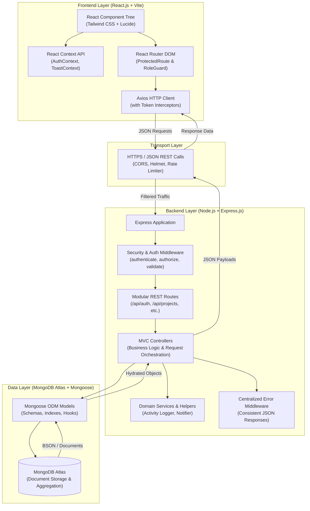
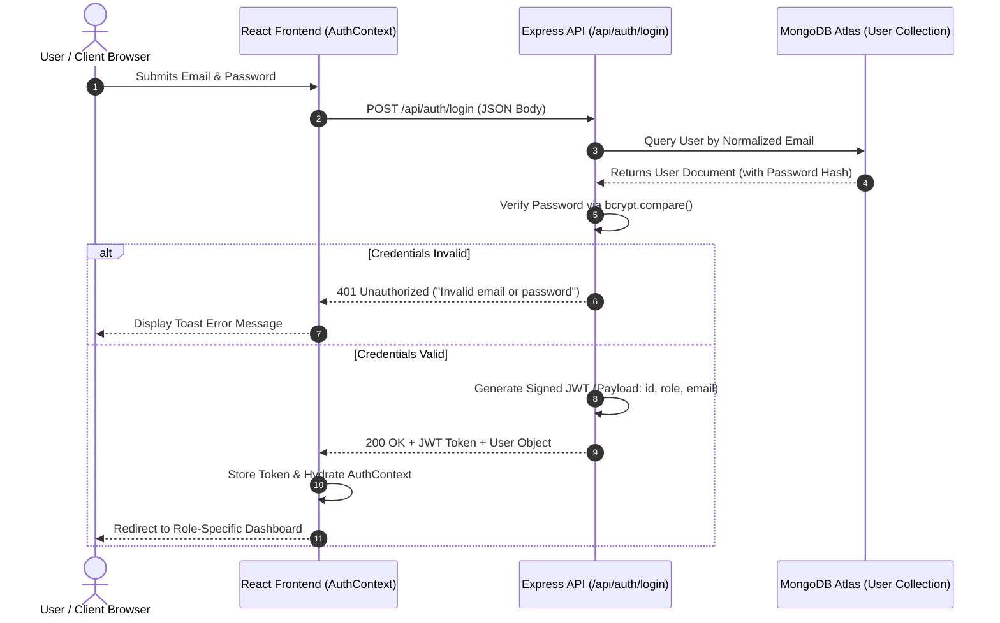
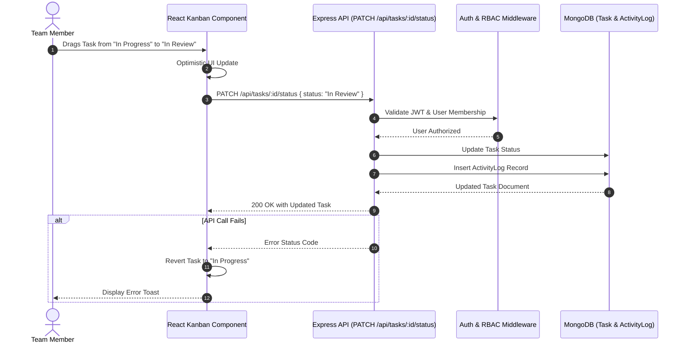

# WorkNest — System Architecture & Data Flow

## 1. Architectural Overview
WorkNest is built as a production-grade multi-tier web application adhering to the classic MERN (MongoDB, Express.js, React.js, Node.js) decoupled architecture. The frontend Single Page Application (SPA) communicates with the backend RESTful API over HTTPS/JSON, enforcing strict statelessness, role-based access control, and defensiveness.

---

## 2. Layer-by-Layer Architecture

### A. Frontend Layer (React 18 + Vite)
- **Component Hierarchy:** Decomposed into reusable presentation components (`Button`, `Card`, `Modal`, `Table`, `Badge`), domain-specific feature modules (`KanbanBoard`, `TaskCard`, `ProjectCard`, `ActivityFeed`), and route-level pages.
- **Routing & Navigation:** `react-router-dom` v6 manages public routes (`LandingPage`, `Login`, `Register`), protected routes requiring authentication (`Dashboard`, `Projects`, `Tasks`, `Profile`), and role-restricted guards (`AdminDashboard`).
- **State Management:** React Context API provides application-wide state for:
  - `AuthContext`: Holds current authenticated user, authentication status, and token lifecycle management.
  - `ToastContext`: Dispatches non-blocking notifications and status feedback.
- **HTTP Client:** Axios instance configured with `baseURL`, credentials support, and response interceptors to catch `401 Unauthorized` errors and automatically route users to login.

### B. Security & API Gateway Layer
- **CORS (Cross-Origin Resource Sharing):** Whitelists client origins in local and production environments, permitting credentialed exchanges.
- **Helmet:** Enforces secure HTTP response headers (`X-Frame-Options`, `X-Content-Type-Options`, `Content-Security-Policy`).
- **Rate Limiting:** Protects sensitive endpoints (e.g. `/api/auth/*`) against brute-force attacks via `express-rate-limit`.

### C. Backend Application Engine (Express.js + Node.js)
- **MVC Architecture:** Separation of routing (`routes/`), request processing & business rules (`controllers/`), data access & validation (`models/`), and cross-cutting concerns (`middleware/`).
- **Middleware Pipeline:**
  1. Body parsing (`express.json({ limit: '10kb' })`).
  2. Security headers & CORS.
  3. Authentication verification (`middleware/authenticate.js` verifies JWT signature and expiration).
  4. Role authorization (`middleware/authorize.js` ensures required roles: `admin`, `manager`, `member`).
  5. Request schema validation (`middleware/validateRequest.js`).
  6. Centralized error handling (`middleware/errorHandler.js` returns uniform JSON structures).

### D. Data Persistence Layer (Mongoose + MongoDB Atlas)
- **Mongoose ODM:** Defines schemas with strict type constraints, required fields, custom validators, pre-save hooks (e.g., bcrypt password hashing), and indexes.
- **Referential Document Integrity:** Models use `mongoose.Schema.Types.ObjectId` references (`ref`) in MongoDB to maintain clean entity relationships across Users, Projects, Tasks, Comments, Notifications, and Activity Logs.

---

## 3. Data & Authentication Flows

### A. User Authentication Flow

### B. Kanban Task Status Update Flow

