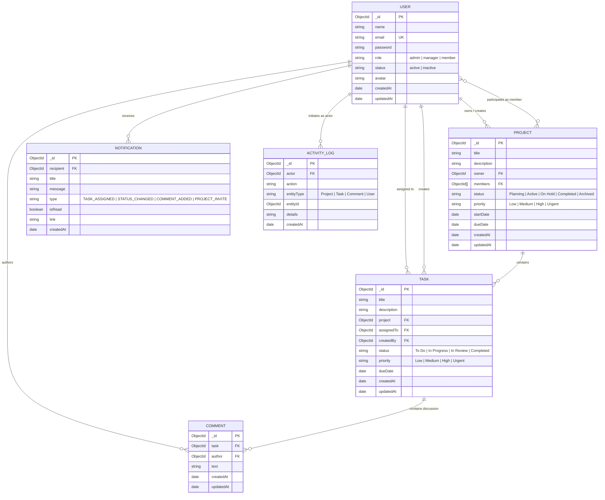

# WorkNest — Database Schema & Data Modeling

## 1. Entity-Relationship Overview
WorkNest is modeled around six document-oriented NoSQL MongoDB collections using Mongoose ODM. WorkNest uses strict referential modeling with `ObjectId` document references to model complex enterprise collaboration workflows.

---

## 2. Collection Schemas & Detailed Field Definitions

### 1. User Collection (`users`)
Stores platform identity, credentials, permissions, and status.
- `_id`: `ObjectId` — Auto-generated Primary Key.
- `name`: `String` — Required, trimmed, 2-60 characters.
- `email`: `String` — Required, trimmed, lowercase, unique index, validated via regex.
- `password`: `String` — Required, hashed with bcrypt (never returned in JSON queries).
- `role`: `String` — Required, Enum: `['admin', 'manager', 'member']`. Default: `'member'`.
- `status`: `String` — Required, Enum: `['active', 'inactive']`. Default: `'active'`.
- `avatar`: `String` — Optional URL/initials fallback.
- `timestamps`: `createdAt`, `updatedAt`.
- **Indexes:** `{ email: 1 }` (unique).

### 2. Project Collection (`projects`)
Represents workspaces containing teams and tasks.
- `_id`: `ObjectId` — Primary Key.
- `title`: `String` — Required, trimmed, 3-100 characters.
- `description`: `String` — Required, trimmed, max 2000 characters.
- `owner`: `ObjectId` (ref: `'User'`) — Required. Project creator/lead.
- `members`: `[ObjectId]` (ref: `'User'`) — Array of assigned team members.
- `status`: `String` — Required, Enum: `['Planning', 'Active', 'On Hold', 'Completed', 'Archived']`. Default: `'Planning'`.
- `priority`: `String` — Required, Enum: `['Low', 'Medium', 'High', 'Urgent']`. Default: `'Medium'`.
- `startDate`: `Date` — Optional / default `Date.now`.
- `dueDate`: `Date` — Required, must be $\ge$ `startDate`.
- `timestamps`: `createdAt`, `updatedAt`.
- **Indexes:** `{ owner: 1 }`, `{ members: 1 }`, `{ status: 1 }`.

### 3. Task Collection (`tasks`)
Represents atomic work items tracked inside projects.
- `_id`: `ObjectId` — Primary Key.
- `title`: `String` — Required, trimmed, 2-150 characters.
- `description`: `String` — Optional, trimmed, max 5000 characters.
- `project`: `ObjectId` (ref: `'Project'`) — Required. Parent project.
- `assignedTo`: `ObjectId` (ref: `'User'`) — Optional. Assignee (must be member or owner of project).
- `createdBy`: `ObjectId` (ref: `'User'`) — Required. Task creator.
- `status`: `String` — Required, Enum: `['To Do', 'In Progress', 'In Review', 'Completed']`. Default: `'To Do'`.
- `priority`: `String` — Required, Enum: `['Low', 'Medium', 'High', 'Urgent']`. Default: `'Medium'`.
- `dueDate`: `Date` — Required.
- `timestamps`: `createdAt`, `updatedAt`.
- **Indexes:** `{ project: 1, status: 1 }`, `{ assignedTo: 1 }`, `{ dueDate: 1 }`.

### 4. Comment Collection (`comments`)
Task-level collaboration and feedback entries.
- `_id`: `ObjectId` — Primary Key.
- `task`: `ObjectId` (ref: `'Task'`) — Required.
- `author`: `ObjectId` (ref: `'User'`) — Required. Comment author.
- `text`: `String` — Required, trimmed, 1-2000 characters.
- `timestamps`: `createdAt`, `updatedAt`.
- **Indexes:** `{ task: 1, createdAt: 1 }`.

### 5. Notification Collection (`notifications`)
User alerts generated on events (assignment, status updates, mentions).
- `_id`: `ObjectId` — Primary Key.
- `recipient`: `ObjectId` (ref: `'User'`) — Required. Notification receiver.
- `title`: `String` — Required.
- `message`: `String` — Required.
- `type`: `String` — Required, Enum: `['TASK_ASSIGNED', 'STATUS_CHANGED', 'COMMENT_ADDED', 'PROJECT_INVITE', 'SYSTEM']`.
- `isRead`: `Boolean` — Default: `false`.
- `link`: `String` — Optional navigation route (e.g. `/projects/123`).
- `createdAt`: `Date` — Default: `Date.now`.
- **Indexes:** `{ recipient: 1, isRead: 1 }`, `{ createdAt: -1 }`.

### 6. ActivityLog Collection (`activitylogs`)
Audit trail tracking significant actions across the application.
- `_id`: `ObjectId` — Primary Key.
- `actor`: `ObjectId` (ref: `'User'`) — Required. User who performed the action.
- `action`: `String` — Required (e.g. `PROJECT_CREATED`, `TASK_STATUS_UPDATED`).
- `entityType`: `String` — Enum: `['Project', 'Task', 'Comment', 'User']`.
- `entityId`: `ObjectId` — ID of the affected resource.
- `details`: `String` — Human-readable description of the mutation.
- `createdAt`: `Date` — Default: `Date.now`.
- **Indexes:** `{ actor: 1 }`, `{ createdAt: -1 }`, `{ entityType: 1, entityId: 1 }`.

---

## 3. Referential Integrity & Validation Rules
1. **Cascade Cleanup:** Deleting a task automatically cleans up its associated comments. Deleting a project archives or cleans up child tasks and logs an activity record.
2. **Project Membership Integrity:** When creating or assigning a task to an `assignedTo` user, the backend verifies that `assignedTo` is present in `project.members` or is `project.owner`.
3. **Date Validation:** In projects, `dueDate` is verified to be equal to or after `startDate`.
4. **Email Normalization:** All user emails are trimmed and converted to lowercase prior to validation and querying to avoid duplicate collisions.
