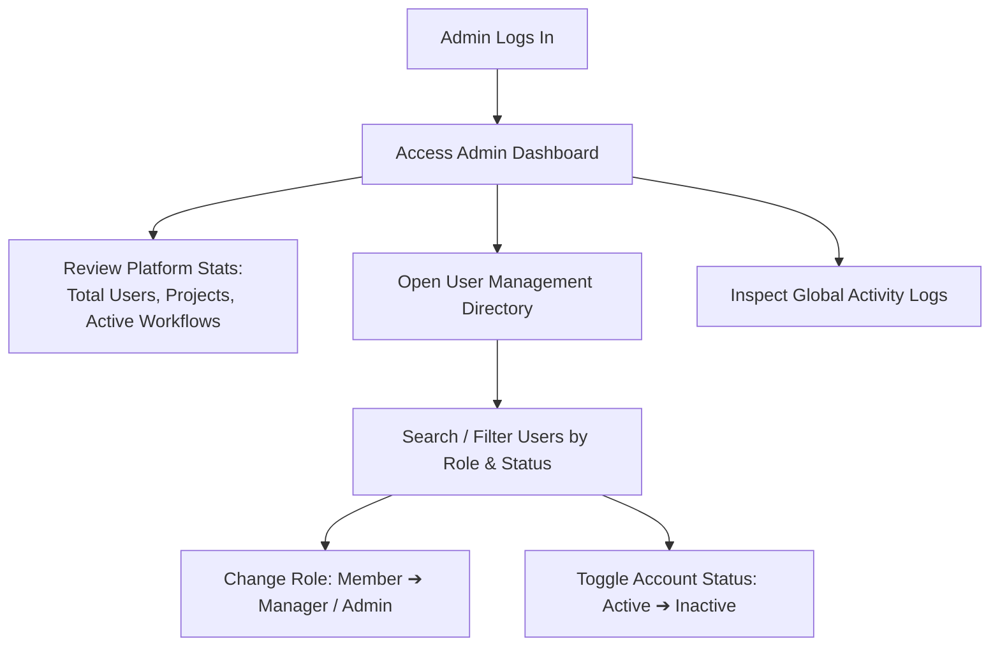
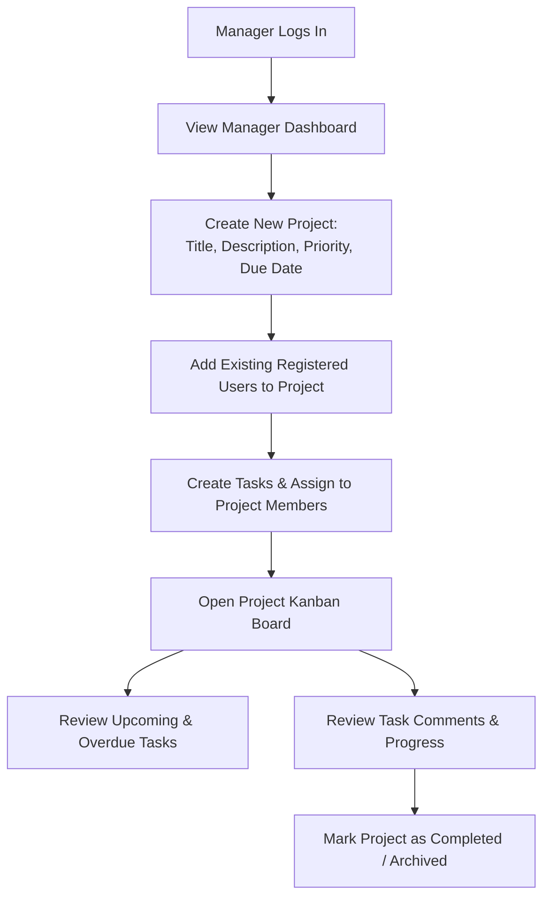
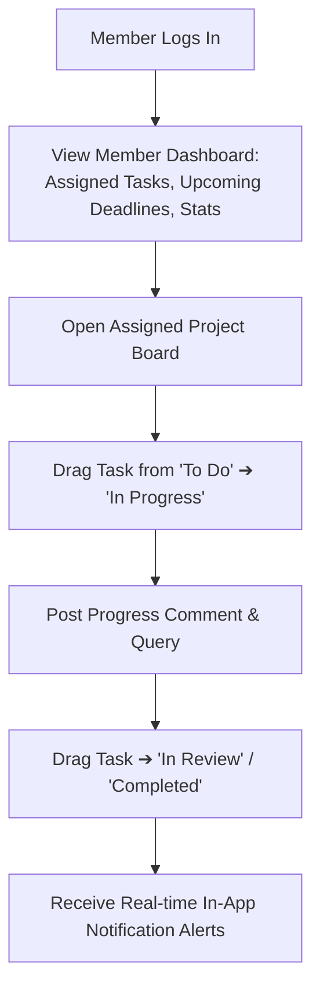

# WorkNest — User Flows & Role Personas

## 1. Overview of User Personas & Permissions

WorkNest models three distinct enterprise user roles, reflecting standard organizational hierarchies:
1. **Administrator (`admin`):** Global platform administrator with administrative governance over all users, projects, system metrics, and audit records.
2. **Project Manager (`manager`):** Team lead responsible for planning projects, adding team members, creating and delegating tasks, and tracking deadlines.
3. **Team Member (`member`):** Individual contributor executing tasks, moving tasks through Kanban stages, and collaborating via task comments.

---

## 2. Comprehensive Role Flows

### Flow 1: Administrator (Platform Oversight & Governance)

### Flow 2: Project Manager (Project Scoping & Delegation)

### Flow 3: Team Member (Task Execution & Collaboration)

---

## 3. Edge Case & Guard Flows
1. **Privilege Escalation Protection:** Any registration request defaults to `member`. Even if a user alters client code to submit `role: "admin"`, backend Mongoose models and controllers explicitly ignore or reject unauthorized role fields.
2. **Deactivated Account Handling:** If an administrator sets a user's status to `inactive`, active JWT sessions are invalidated upon database checks, and login attempts return `401 Unauthorized: Account is inactive`.
3. **Cross-Project Isolation:** A team member can only view and interact with projects where they are explicitly added to `members` or are the `owner`. Direct URL manipulation (`/projects/unauthorized-id`) triggers an authorization guard resulting in a `403 Forbidden` state.
